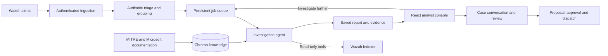
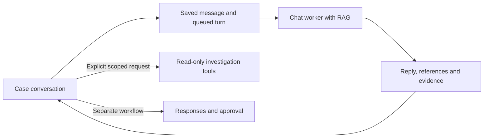

# CyberTriage

CyberTriage investigates Wazuh alerts using local language models, security
references and read-only investigation tools. Analysts can read the agent's
report, gather more evidence, manage cases and review proposed responses in a
separate React application.

## How it works



| Area | Available now |
| --- | --- |
| Alerts | Authenticated Wazuh ingestion, deduplication, bounded grouping and auditable suppression. |
| Investigation | Persistent workers, retries, crash recovery and bounded read-only searches. |
| Knowledge | Chroma retrieval, event catalogue and cached public-document lookups from allowlisted sources. |
| Analyst console | Persistent case conversations, agent reports, retained alerts, timelines and analyst feedback. |
| Graphs | Evidence relationships and reviewed Cyber Kill Chain assessments; optional Neo4j projection. |
| Responses | Separate proposal, approval and execution workflow with an OPNsense adapter. |

Reports are provisional. A model recommendation does not confirm compromise or
authorize a response. Missing events and incomplete searches remain evidence gaps.

## Run with Docker

You need:

- Docker Engine with Compose on Linux, or Docker Desktop on Windows.
- An existing Ollama service with the configured chat model and `nomic-embed-text`.
- A reachable Wazuh Indexer, its public CA and a read-only search account.
- The same ingestion token in Wazuh and CyberTriage.

### 1. Configure

From the repository root, run the launcher for your operating system:

| Linux | Windows PowerShell |
| --- | --- |
| `bash scripts/cybertriage.sh configure` | `./scripts/cybertriage.ps1 configure` |

The launcher prompts privately for the ingestion token and Indexer password.
Existing configuration is preserved. 
Edit `.env.docker.local` and copy the **public** Indexer CA to
`config/certs/indexer-ca.pem`:

| Setting | Value |
| --- | --- |
| `CYBERTRIAGE_INDEXER_URL` | HTTPS Indexer endpoint matching the certificate's SAN. |
| `CYBERTRIAGE_INDEXER_USERNAME` | Read-only Indexer account. |
| `CYBERTRIAGE_OLLAMA_URL` | Linux defaults to `http://127.0.0.1:11434`; Windows uses `http://host.docker.internal:11434`. |
| `CYBERTRIAGE_MODEL` | An installed chat-model tag; default `qwen3:4b-instruct`. |

See [analyst authentication](docs/architecture/analyst-api.md) for permissions,
expiry and credential rotation.

For a loopback-only Indexer reached through an SSH tunnel:

- **Linux:** keep the host tunnel open and set the Indexer URL to its verified
  loopback endpoint. The Linux launcher uses host networking for the model
  workers so they can reach local Ollama and the tunnel.
- **Windows:** set the verified loopback URL and enable
  `CYBERTRIAGE_INDEXER_FORWARD_HOST=host.docker.internal` plus the matching
  `CYBERTRIAGE_INDEXER_FORWARD_PORT`. The internal relay preserves TLS verification.

The Linux override targets native Docker Engine. See [container deployment](docs/architecture/containers.md)
for network boundaries and file permissions.

### 2. Build and prepare knowledge

| Task | Linux | Windows PowerShell |
| --- | --- | --- |
| Build images | `bash scripts/cybertriage.sh build` | `./scripts/cybertriage.ps1 build` |
| New installation: fetch and index references | `bash scripts/cybertriage.sh knowledge` | `./scripts/cybertriage.ps1 knowledge` |
| Migrate existing local data instead | `bash scripts/cybertriage.sh import-data` | `./scripts/cybertriage.ps1 import-data` |

Choose **knowledge** for a fresh installation, or **import-data** for an existing
`data/alerts`, `data/catalogs` and `data/chroma` installation. Import requires an
empty destination and stopped native/backend processes. It preserves the host
files and refuses to overwrite existing container data.

Knowledge preparation makes explicit network requests and embedding calls.
Startup never downloads model weights. Stop the stack before subsequent knowledge
maintenance; normal startup reuses the stored corpus.

### 3. Start

```bash
# Linux
bash scripts/cybertriage.sh start
```

```powershell
# Windows
./scripts/cybertriage.ps1 start
```

Open **http://127.0.0.1:5173** and sign in with your analyst token. The ingestion
endpoint is **http://127.0.0.1:8000/api/v1/alerts/wazuh**. Wazuh on a VM needs an
existing secure host transport to that endpoint; guest localhost is a different
machine. See [operations](docs/operations.md) for connectivity and process details.

| Operation | Linux | Windows PowerShell |
| --- | --- | --- |
| Service health | `bash scripts/cybertriage.sh status` | `./scripts/cybertriage.ps1 status` |
| Follow logs | `bash scripts/cybertriage.sh logs` | `./scripts/cybertriage.ps1 logs` |
| Stop, retaining data | `bash scripts/cybertriage.sh stop` | `./scripts/cybertriage.ps1 stop` |
| Include Neo4j | `bash scripts/cybertriage.sh start --graph` | `./scripts/cybertriage.ps1 start -Graph` |

The analyst API is private behind the frontend's verified HTTPS proxy. Bindings
above are local-only; remote browser access needs an HTTPS ingress. Named volumes
retain evidence across restarts. Back them up before upgrades or migration.

## Work with the agent

Open a case to start its **Conversation**, or use **+** beside **Case conversations**
in the sidebar to create one. Describe the incident and send a message. The agent's
reply appears in the same thread; follow-up questions reuse bounded case and
conversation context. Existing cases remain available in the sidebar.

**Discuss / review** uses the supplied case context and references. Attach Wazuh
alerts through **Evidence**, then choose **Investigate with read-only tools** to
allow scoped searches. Select an evidence focus when the case has many alerts.
No VM evidence is invented for a case described only in chat.



Replies are processed by `case-chat-worker` and remain available after leaving
or reloading the page. **Evidence and sources** opens the provenance for each
reply. Chat requests never execute or approve a response; **Responses** opens
that separate workflow.

The sidebar's **Saved reports** page remains a saved-report browser. It includes
automatic analyses and alert-backed chat reports. Case-only conversations are
retained in their case thread rather than assigned a fabricated Wazuh alert.
See the [analyst guide](docs/analyst-guide.md) for access, job states and context limits.

## Develop locally

Python **3.12** is the reference environment. Create a virtual environment and
install the package from the repository root:

```bash
python -m venv .venv
# Linux: source .venv/bin/activate
# Windows PowerShell: ./.venv/Scripts/Activate.ps1
python -m pip install -e .
python -m cybertriage --help
```

For native frontend development, use Node 22.12 or newer:

```bash
cd apps/analyst-web
npm ci
npm run dev -- --host 127.0.0.1
```

Configure the frontend's API proxy using its [.env.example](apps/analyst-web/.env.example).
The Docker frontend needs no host Node installation.
Native knowledge and worker commands are in the [CLI guide](docs/cli.md).

## Project structure

```text
src/cybertriage/
  domain/          Alert, case, evidence and response concepts
  application/     Use cases, policies and adapter interfaces
  adapters/        Wazuh, storage, retrieval, models and firewall integrations
  entrypoints/     CLI and HTTP APIs
apps/analyst-web/   Independent React application
config/            Source, triage, authentication and response policies
docker/            Container startup, migration and health checks
scripts/           Platform launchers and validation tools
docs/              Architecture, operation and evaluation guides
```

## Documentation and status

| Guide | Contents |
| --- | --- |
| [Analyst guide](docs/analyst-guide.md) | Reports, alerts, cases and review workflow. |
| [CLI guide](docs/cli.md) | Native commands and operational examples. |
| [Architecture](docs/architecture.md) | Application boundaries and design. |
| [Retrieval](docs/architecture/retrieval.md) · [Live sources](docs/architecture/live-web.md) | Knowledge ranking, provenance and public lookups. |
| [Containers](docs/architecture/containers.md) · [Operations](docs/operations.md) | Deployment, maintenance, credentials and backups. |
| [Case graphs](docs/architecture/graph.md) | Observations, hypotheses and Kill Chain assessments. |
| [Response workflow](docs/architecture/response-workflow.md) | Approval, execution, expiry and reconciliation. |
| [Evaluation](docs/evaluation.md) · [Implementation status](docs/implementation-status.md) | Recorded results and outstanding acceptance work. |

The end-to-end Wazuh ingestion and worker path has been exercised in a lab.
Later integrations have separate acceptance status; implemented does not mean
production-certified. Cloud chat-provider adapters and reinforcement-learning
training are not implemented. Model output quality still requires evaluation.
