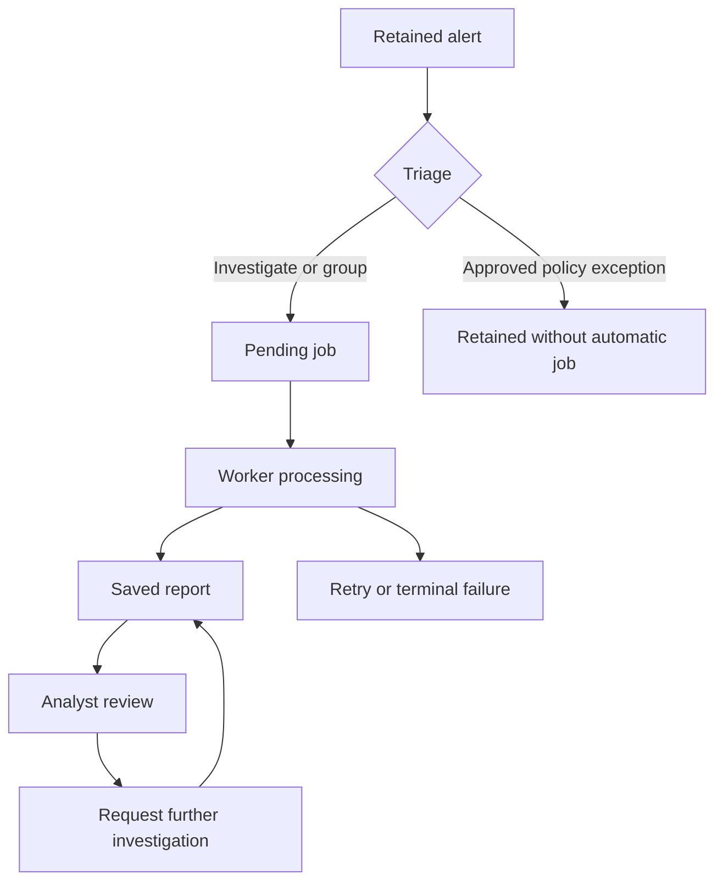

# Analyst guide

## Case conversations

Open a case to enter its Conversation tab. The sidebar lists recent entries
from the loaded authorized case page; Browse all cases opens the full paginated
case queue. The + button creates a case and opens its conversation.

Describe the incident or select Prepare a case review, then send the message.
The message is retained immediately and a chat worker generates the reply.
Questions and replies share the thread. Leaving the page does not cancel queued
work, and reloading restores the saved conversation.

Discuss / review mode does not run investigation tools. It can discuss reported
context even before any Wazuh alerts are attached. Attach retained alerts from
Evidence to ground the discussion in telemetry. Investigate mode enables the
existing read-only tools within a scope derived from the selected attached
alert's structured identity, host and time. Free-text requests cannot enlarge
that authority or execute firewall commands.

With no explicit focus, at most five active attached alerts become input. Cases
with more alerts require a selected focus. Evidence and sources on each reply
shows its input, references and tool observations. Earlier saved reports are
unverified background context, not proof of the current incident.

Conversation storage retains the whole thread up to its 1,000-turn limit. Each
model request receives a bounded snapshot: up to eight recent turns, excerpts
of earlier answers, historical query summaries and up to two linked report excerpts. History that does not
fit the context budget is omitted with a visible indicator. The model does not
receive unlimited memory. Selected alert projections must fit the input budget.
When raw `full_log` JSON repeats the decoded payload, it is excluded from the model
projection to avoid repetition; the omission is recorded and the original alert
remains available in Evidence. Excessive context produces an explicit failure
instead of a partial accepted reply. Conversation answers normally stay within
200 words, with two retrieved knowledge chunks plus any exact event definition.

One turn can be pending/running per case. Submission keys make retries
idempotent. The worker uses renewable leases and at most three attempts; a stale
worker cannot save a reply. Incomplete output and context-budget failures end
the turn without repeating an unchanged generation. A failed turn remains in history and can be followed
by a new message after the cause is resolved. Responses opens the separate
proposal/approval workflow. Chat never grants response authority.

## Read the agent's report

Open **Saved reports** in the sidebar. It lists saved automatic analyses and
requested investigations, whether or not their alerts belong to a case.
The first report in the newest-first list opens below it. Select a report to
read its analysis, references, tool results and exact stored input evidence.
Refresh retrieves saved state; it does not request model generation.

**Alert inbox → Saved reports** filters the list to reports whose anchor or
recorded coverage includes that alert. Grouped alerts share an automatic job;
their distinct evidence remains retained. Old reports without coverage metadata
are identifiable by their anchor only. A zero coverage count does not establish
that every alert in a case was analyzed.

The **Saved reports** tab inside a case lists reports covering attached evidence.
Saved reports appear before follow-up requests. Selecting a report opens its
stored analysis and evidence. Neither attaching an alert nor opening a case
automatically starts an investigation.

## When a report is missing

| Saved state | Meaning and next check |
| --- | --- |
| Pending | The job has not completed. Check worker availability and queue state. |
| Running | A worker holds the claim. Model/tool latency can delay completion. |
| Failed | Attempts ended without an accepted report. Inspect the saved error and worker logs. |
| Suppressed / no automatic job | A triage policy retained the alert without scheduling analysis. Review the decision before releasing it. |
| Completed | A report was saved. Refresh Agent review; completion does not certify the model's claims. |
| Restricted | The credential lacks global evidence scope or `reports:read_all`. |

Ingestion HTTP 201 means the alert was retained, not that an agent report already
exists. The inbox shows the representative job for grouped members. Suppression,
duplicate delivery and report completion are separate states.

Reports can include evidence outside a case's attachments, so full report access
currently requires both `case_ids: ["*"]` and `reports:read_all`. Case-scoped
credentials retain their narrower case access.

## Investigate a case

1. Create a case with a clear scope and attach retained alert record IDs.
2. Read its evidence and agent reports. Keep observed events separate from
   hypotheses and gaps in collection.
3. Use **Investigate further** to queue a bounded read-only objective anchored
   to an attached alert. The investigation worker saves a new report.
4. Add notes and review relationships or Cyber Kill Chain assessments against
   specific evidence. A shared IP or nearby timestamp alone does not prove a
   common attacker or causal sequence.
5. Record the case finding with supporting alerts and a reason. Model text
   remains an input to that review, not approval authority.

## Review responses

Responses have a separate tab and workflow: proposal, analyst approval and
dispatch. Reading an agent report requires no firewall configuration.
Execution needs enabled server policy, a configured executor and the appropriate
credential permissions. See the [response workflow](architecture/response-workflow.md).

Sign in with your provisioned username/password, or select API token for an
existing integration credential. Password login creates a 15-minute session.
The console keeps its bearer in page memory; Lock signs out and requests server
revocation. Reloading requires signing in again. Case conversations remain saved
when a login session expires.
