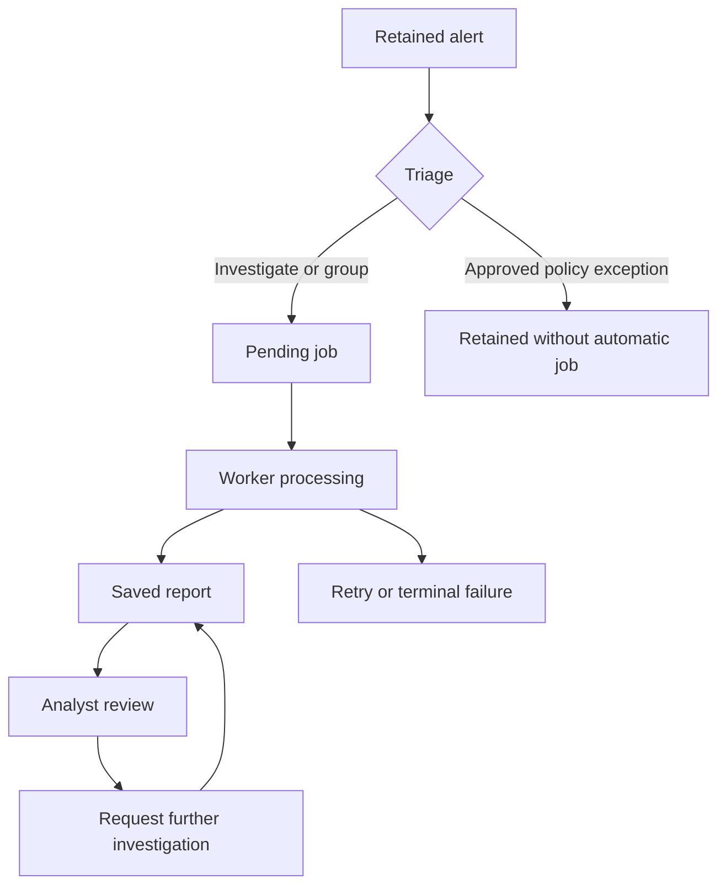

# Analyst guide

## Read the agent's report

Open **Agent review** in the sidebar. It lists saved automatic analyses and
requested investigations, whether or not their alerts belong to a case.
The first report in the newest-first list opens below it. Select a report to
read its analysis, references, tool results and exact stored input evidence.
Refresh retrieves saved state; it does not request model generation.

**Alert inbox → Agent review** filters the list to reports whose anchor or
recorded coverage includes that alert. Grouped alerts share an automatic job;
their distinct evidence remains retained. Old reports without coverage metadata
are identifiable by their anchor only. A zero coverage count does not establish
that every alert in a case was analyzed.

The **Agent review** tab inside a case lists reports covering attached evidence.
Saved reports appear before follow-up requests. Selecting a report opens its
stored analysis and evidence. Neither attaching an alert nor opening a case
automatically starts an investigation.

## When a report is missing

| Saved state | Meaning and next check |
| --- | --- |
| Pending | The job has not completed. Check worker availability and queue state. |
| Running | A worker holds the claim. Model/tool latency can delay completion. |
| Failed | Attempts ended without an accepted report. Inspect the saved error and worker logs. |
| Suppressed / no automatic job | A triage policy retained the alert without scheduling analysis. Review the decision before releasing it. |
| Completed | A report was saved. Refresh Agent review; completion does not certify the model's claims. |
| Restricted | The credential lacks global evidence scope or `reports:read_all`. |

Ingestion HTTP 201 means the alert was retained, not that an agent report already
exists. The inbox shows the representative job for grouped members. Suppression,
duplicate delivery and report completion are separate states.

Reports can include evidence outside a case's attachments, so full report access
currently requires both `case_ids: ["*"]` and `reports:read_all`. Case-scoped
credentials retain their narrower case access.

## Investigate a case

1. Create a case with a clear scope and attach retained alert record IDs.
2. Read its evidence and agent reports. Keep observed events separate from
   hypotheses and gaps in collection.
3. Use **Investigate further** to queue a bounded read-only objective anchored
   to an attached alert. The investigation worker saves a new report.
4. Add notes and review relationships or Cyber Kill Chain assessments against
   specific evidence. A shared IP or nearby timestamp alone does not prove a
   common attacker or causal sequence.
5. Record the case finding with supporting alerts and a reason. Model text
   remains an input to that review, not approval authority.

## Review responses

Responses have a separate tab and workflow: proposal, analyst approval and
dispatch. Reading an agent report requires no firewall configuration.
Execution needs enabled server policy, a configured executor and the appropriate
credential permissions. See the [response workflow](architecture/response-workflow.md).

The console keeps the analyst token in page memory. Locking, reloading or
inactivity ends the browser session; server-side credential expiry still applies.
