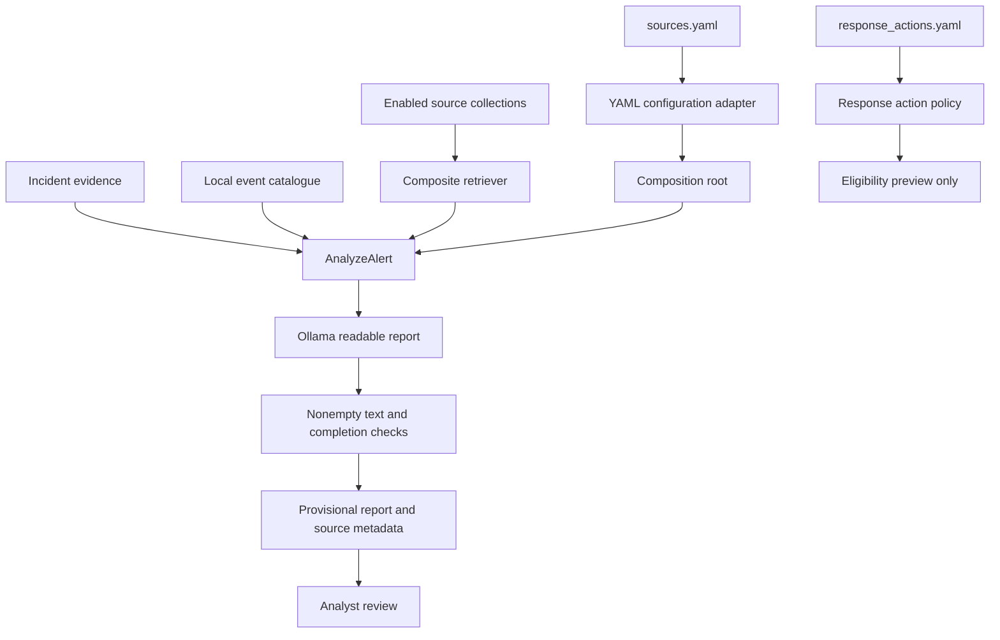

# Architecture and trust boundaries

CyberTriage uses ports and adapters (hexagonal architecture), with constructor
injection and factories in the composition root.

## Responsibilities and SOLID

- **Single responsibility:** YAML adapters parse configuration; source adapters
  fetch documents; the model adapter handles generation; the policy decides
  action eligibility; entrypoints handle arguments and presentation.
- **Open/closed:** application use cases work through small contracts. Source
  factories and action validators are registered in the composition root.
  New integrations require adapters/configuration wiring rather than changes
  to analysis orchestration.
- **Substitution:** source implementations expose `fetch()`, model adapters
  expose `analyze() -> str`, and retrievers expose `retrieve()`. They must
  preserve the meaning of these contracts, including visible failures.
- **Interface segregation:** knowledge configuration, response configuration,
  retrieval, generation, source loading and action parameter validation use
  separate protocols; analysis does not depend on action execution methods.
- **Dependency inversion:** application use cases depend on protocols and domain
  objects. They do not import YAML, Chroma, Requests, or Ollama clients.

## Patterns used

- **Ports and adapters:** domain/application code is separated from integrations.
- **Dependency injection:** use cases and policies receive their collaborators.
- **Factory registry:** `bootstrap._source_bindings()` connects configured source
  names to source factories and collections.
- **Strategy:** model, retrieval, configuration and parameter-validation ports
  allow alternative implementations.
- **Composite:** `FederatedKnowledgeRetriever` combines configured retrievers.
- **Policy object:** `ResponseActionPolicy` evaluates a concrete action proposal.

These patterns are used where there is an actual boundary. Empty architecture
folders do not represent completed features.

## Runtime configuration

`YamlKnowledgeConfiguration` reads `config/sources.yaml` into immutable typed
settings. Ingestion uses its revision, page list, URLs and chunking values.
Analysis uses its enabled sources and collection names. Catalogue updates use
its configured catalogue URL. Parsing rejects duplicate keys, unknown fields,
unsupported YAML tags/aliases, and invalid value types.

`YamlResponseConfiguration` reads `config/response_actions.yaml`. It configures
allowed action/target pairs, parameters, limits, protected networks and approval
lifetime. `PreviewResponseAction` calls the policy without supplying approval;
it cannot approve or execute anything.

## Readable analysis baseline

`TriageModel.analyze()` returns ordinary text. There is no required model JSON
schema, account-name substitution, generated-quote matching, or corrective loop.
A blank, non-text, or unfinished response fails visibly. These are generation
checks, not factual certification.

The prompt asks the model to separate facts, hypotheses, missing evidence,
investigation checks and conclusions. Catalogue definitions and incident event
metadata are kept distinct. Retrieved references provide background knowledge,
not additional incident facts. The report and source metadata can be saved as
application JSON without asking the model to generate JSON.

## Response boundary

Current code includes policy evaluation, not an execution backend. Policy
configuration requires both confirmed compromise and explicit analyst approval.
Approval is bound to a fingerprint of the case, action, target and parameters,
and has a configured lifetime. An action must also have a registered parameter
validator. The current block-IP validator checks the address, duration and
protected networks, including IPv4-mapped address forms.

The future authenticated case-review workflow must obtain disposition and
approval from trusted stored records, not model prose or arbitrary client flags.
The CLI disposition flag is only a what-if preview. It creates no review record.
Firewall executors, persisted approvals, authentication and auditing remain to
be implemented. The model has no shell or firewall execution capability.

## Verification ownership

The project owner will perform testing. No tests or model runs are executed as
part of the current coding-only changes. Existing evaluation scripts remain
available for deliberate manual use, and report generation completion is not
labelled as semantic validation.
