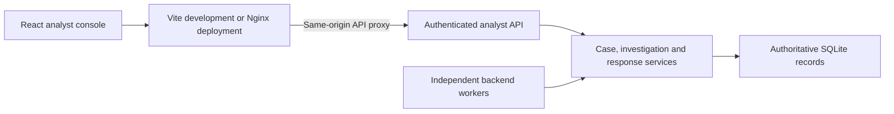

# Analyst web application

The analyst console is a React application in `apps/analyst-web`. It is a
separate deployable frontend with its own package manifest, build and container.
FastAPI remains the analyst JSON API. SQLite, models, knowledge retrieval and
device operations stay behind the existing application ports and adapters.

This deployment boundary allows independent frontend releases. It does not
change the backend's single-host SQLite storage assumptions. Installation,
credential provisioning, local commands and container configuration are in the
[README](../../README.md#react-analyst-application).

## Component boundaries

| Location | Responsibility |
| --- | --- |
| `src/api/client.js` | Same-origin authenticated HTTP, bounded responses, cancellation and explicit uncertain outcomes. |
| `src/auth/Session.jsx` | Credential lifetime and permission/case-scope presentation. |
| `src/hooks/useData.js` | Resource loading, bounded pagination, cancellation and case-version conflicts. |
| `src/components` | Shared presentation and explicit mutation dialogs. |
| `src/features` | Case/evidence review, reports and requests, graph, response workflow and triage quality. |
| `src/App.jsx` | Session entry and workspace navigation. |
| `src/styles.css` | Shared spacing, typography, restrained status colors and responsive layout. |
| `vite.config.js`, `docker`, `compose.yaml` | Development proxy and independently served production assets. |

Feature components use the API transport rather than importing storage, model
or firewall integrations. Small hooks separate asynchronous request lifecycle
from presentation; the backend remains the source of workflow authority.

## Analyst workflow

The case queue shows loaded-case counts, not invented organization-wide totals.
The alert inbox retains source IDs separately from local record IDs. Cases expose
evidence, timeline, saved reports, requested investigations, relationship reviews,
Kill Chain assessments, response proposals and audit history.

Observed field relationships and hypotheses remain separately labelled. The graph
renders the authoritative case projection, including source version, supporting
properties and unassessed Kill Chain stages. Framework order and reported-time
order are distinguished from observed relationships; neither establishes an
attacker's causal path. The browser displays at most 160 nodes and 500 edges,
with visible matching/total counts and filtered views. Graph reading does not
require a direct browser connection to Neo4j.

Mutation dialogs require explicit submission and use backend versions where the
API supports optimistic concurrency. Conflicts mark the case stale. Responses
retain separate proposal, approval and dispatch steps; execution confirmation
includes the exact target and an acknowledgement. Unknown dispatch/removal
outcomes require recorded reconciliation after device inspection. The console
does not automatically retry mutations or turn model text into approval.

Investigation status polling is read-only, bounded and paused in hidden tabs.
List views use bounded pages; reaching the browser display limit is visible.
Report text, logs and source strings render as text, not executable markup.

## Authentication and transport

Each analyst enters a provisioned high-entropy API token. It is held in private
page memory, never local/session storage, browser URLs or build configuration.
Locking, page exit and 15 minutes of inactivity clear credentials and abort
pending requests. The API still controls expiry, revocation and authorization;
frontend permission checks only determine which controls are presented.

Same-origin `/api/v1/` requests carry the bearer token through the frontend proxy.
No cross-origin browser credentials or wildcard CORS are needed. Remote
development upstreams require trusted HTTPS. Production Nginx verifies HTTPS
upstreams using an explicit CA and TLS name; cleartext HTTP is suitable only for
an appropriately isolated trusted hop. Browser ingress requires HTTPS when
exposed beyond local loopback.

The container runs unprivileged with a read-only filesystem and temporary
runtime storage. Nginx disables API retries and response caching; CSP permits
only same-origin compiled scripts/styles and connections. The frontend contains
no Indexer, firewall or model secrets. These controls still require deployment
verification, dependency review and an appropriate host/ingress configuration.

## Acceptance status

JavaScript/JSX syntax and repository-local imports have been checked statically.
The frontend lockfile is present for `npm ci` and container builds. Bundle
compilation, rendered design/accessibility, browser
authorization flows, concurrency, interrupted-operation recovery and deployment
TLS/CSP/container behavior have not yet been validated.
