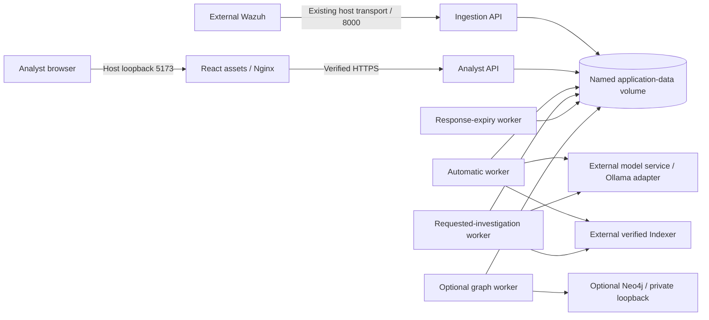

# Container deployment

The root Compose project supplies one lifecycle for independently running
frontend, API and worker containers. Domain/application services retain their
existing ports and adapters; deployment wiring selects container addresses,
storage, credentials and process commands. Installation, migration and commands
are in the [README](../../README.md#run-with-docker).

## Startup and process ownership

Bootstrap initializes named-volume ownership and a private API certificate.
It performs no knowledge download, model generation, response dispatch or
credential provisioning. API health gates the frontend/requested worker/expiry
worker; ingestion health gates automatic analysis. The model runtime is external.
Worker startup verifies existing model tags, knowledge files and Indexer
configuration before claiming work. Missing prerequisites fail visibly.

Compose restart policies recover exited long-running containers. The container
wrapper forwards shutdown to its child, allows up to 195 seconds, and retains
the existing lease/recovery contracts for interrupted work. The 210-second
Compose stop budget gives the wrapper time to finish. Starting the stack does
not execute pending response proposals or bypass stored approval requirements.

Worker health reports a live wrapper/child process, not completed work or
semantic correctness. API/ingestion health reports process liveness; Neo4j's
authenticated constant-query check precedes schema initialization. Compose does
not automatically restart a container solely because its health becomes
unhealthy. Source/network failures and unresolved response outcomes remain
operational conditions to investigate.

## Network and credential boundaries

Only web and ingestion listeners are published, both to host loopback by
default. Remote Wazuh delivery still needs an appropriate host tunnel or secure
ingress. Frontend-to-API traffic uses verified HTTPS with the `analyst-api`
certificate identity. Nginx resolves upstream Docker DNS periodically so API
replacement does not leave a permanently cached address.

The frontend mounts public API trust only. The private server key is mounted
only into the API. Bootstrap's CA signing key is temporary and is not retained;
the issued certificate has a one-year lifetime. Expiring/incomplete material
fails bootstrap rather than disabling TLS or silently rotating authority.
Certificate replacement requires stopping the stack and controlled replacement
of both TLS/trust volumes before restarting their consumers.

An optional worker-local TCP forward preserves a loopback-only Indexer
certificate when the existing transport is a Windows SSH listener. The HTTPS
origin remains `127.0.0.1`; the forward relays opaque encrypted bytes to the
configured host/port and neither terminates TLS nor logs credentials. Its
listener is loopback-only, connections are bounded and idle connections expire.
Docker Desktop supplies `host.docker.internal`; the external SSH listener must
remain available. Startup verifies TLS and read-only search authorization with
a match-none query before the worker can claim jobs. This is transport readiness,
not an assessment of collection completeness or incident findings.

Compose mounts ingestion and Indexer secrets only into the corresponding
services. The container entrypoint supports bounded `CYBERTRIAGE_*_FILE`
credentials without logging their contents. Analyst configuration contains token
hashes; private configuration, secret files and certificates are excluded from
image build contexts and Git. Optional firewall credentials can be supplied to
the API and expiry worker through ignored `config/firewall.local.env`, or a
deployment override with Docker secrets and the `_FILE` convention. Firewall CA
paths in target configuration must refer to explicitly mounted container paths.

The model runtime has an independent lifecycle. Compose contains no Ollama
server, model-image dependency, weight mount or model-data volume. The current
Ollama adapters use an environment-selected URL; the native localhost default
and embedding model remain unchanged. Docker Desktop workers reach a host
service through `host.docker.internal`. HTTP is limited to loopback and this
trusted local development gateway; remote origins require verified HTTPS.

Application services depend on the `TriageModel` and `InvestigationModel` ports;
the composition root currently binds Ollama implementations. A provider API
requires its own adapter and startup/credential configuration. It is not enabled
merely by substituting a different URL. Chat and embedding adapters remain
independent, allowing a hosted chat model with the existing local embeddings.

The optional graph processes share Neo4j's network namespace and connect to its
loopback-only Bolt listener. Neo4j publishes no host port and its HTTP endpoints
are disabled. This retains the existing rule that plaintext Bolt is allowed
only on loopback. The dedicated local database account is provisioned from a
secret; a separate service initializes the required uniqueness constraint.
The new destination namespace prevents reusing another destination's delivery
cursor. SQLite remains authoritative; Neo4j is a rebuildable projection.

## Data lifecycle

Backend services share one Docker-managed volume on the Docker host. A
maintenance lock permits runtime readers/processes together but excludes data
import and knowledge-update maintenance. SQLite transactions/leases continue
to coordinate individual records; the deployment lock is not a replacement
for those application invariants. Multi-host writers remain unsupported.

The explicit importer stages alert/catalogue/Chroma copies, snapshots SQLite
databases including committed WAL data, rejects symlinks and refuses to
overwrite existing container data. The native source must be stopped before
copying. Unresolved response executions and outstanding/unresolved block leases
block migration because device/CA/configuration bindings may change. Exception
rollback restores staged directories; a forcibly interrupted import may require
inspection of partial volume contents before retry. Host source data is retained.

Backups must include the authoritative volume and configuration. Ordinary
`down` retains volumes; removing volumes discards retained evidence and local
database state. Model concurrency/resource limits belong to the external
runtime's configuration and still require workload measurement.

## Acceptance

Python/PowerShell parsing and Compose configuration validation were performed.
Image builds, Windows bind mounts, imported Chroma compatibility, runtime health,
credential scopes, external Indexer/VM transport, shutdown during work, Neo4j
publication and real firewall expiry have not yet been validated in this layout.
Release preparation also requires dependency/image locking and deployment-specific
ingress, backup, recovery and secret-management verification.

## Linux launcher

`scripts/cybertriage.sh` supplies the same configure/build/knowledge/import/start/
stop/status/logs lifecycle as the Windows PowerShell launcher. It passes the
explicit environment file to Compose without evaluating it as shell code.
Configure preserves existing files; a fresh installation receives a distinct
30-day analyst credential with investigation/review permissions and no response
permissions. Only its hash is saved. Subsequent runs do not print an existing token.

The Linux launcher merges `compose.linux.yaml`. The automatic, requested-investigation and case-chat
workers use native Docker Engine host networking to reach
host-local Ollama and an existing loopback SSH Indexer tunnel. They expose no
listening application port, but share the host network namespace rather than
bridge isolation. Other services keep their original network boundaries. Remote
model/Indexer endpoints still require the configured verified transport.
The Windows launcher uses the base Compose file and its existing relay instead.

Linux secret files are individually mounted by Compose. Their host directory
is private (0700), while the mounted files are readable (0644) by the unprivileged
container accounts. This allows file-backed Compose secrets to work without
assuming UID/mode remapping. Host users cannot traverse the private directory;
Docker administrators retain access. See [Docker's secret handling](https://docs.docker.com/compose/how-tos/use-secrets/).
For managed deployments, use the deployment's secret manager and mount policy.

`knowledge` explicitly prepares the catalogue and configured Chroma collections
inside the volume. It runs only on request with backend processes stopped.
`import-data` remains the alternative for migration into an empty destination.
Neither launcher removes volumes on stop. Linux runtime acceptance remains
pending; Compose configuration validation does not establish it. Shell syntax
execution was unavailable in the Windows environment.

## Conversation worker

`case-chat-worker` is an independent supervised service sharing the existing
application-data volume. It uses the same external model, knowledge corpus,
read-only Indexer configuration and transport relay. Startup verifies model and
knowledge prerequisites. Indexer readiness is checked by the actual tool request,
so an unavailable VM does not prevent tool-free case discussion. Review mode
exposes no tools. Investigate mode retains the existing application-derived
scope and source-failure semantics.
